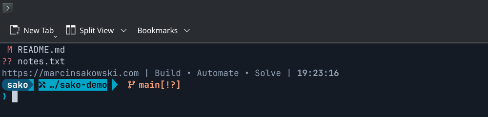

# SAKO Terminal Theme

**Build • Automate • Solve**

A three-line Fish + Starship prompt with the SAKO palette, plus a portable
installer that sets it up on CachyOS, Arch, Debian, Ubuntu, Mint and Fedora.

**One theme. One installer. Multiple Linux environments.**

[Polski README](README.pl.md)



## Quick start

```bash
git clone https://github.com/Sako404/sako-terminal-theme.git
cd sako-terminal-theme
./install.sh
```

The installer shows a plan (missing packages, files it will create or
replace), asks once, backs up everything it touches, applies the theme and
then verifies it in a fresh Fish process. Run it again at any time: it only
changes what is out of date.

No git on a brand-new machine? See [docs/installation.md](docs/installation.md#without-git).

## What you get

| Layer | What | Needs a GUI? |
|---|---|---|
| **Core theme** | Starship prompt (3 lines, Powerline segments, Nerd Font icons), branding line with the live clock, Fish autosuggestion colour `#7f8c9a` | No — works over SSH and in a TTY |
| **Terminal integrations** (optional) | Colour scheme + font for KDE Konsole, Kitty, Alacritty, WezTerm | Only the emulator itself |
| **Installer** | Dependency installation, backups, restore, update, uninstall, diagnostics | No |

The core theme is what draws the prompt; it looks the same in any terminal
that has a Nerd Font. Integrations only set the emulator's background,
16 ANSI colours and font so the prompt sits on the intended palette.

The visual theme targets **Fish + Starship**. The installer runs from any
shell (bash, zsh, fish), but it does not theme Bash or Zsh prompts.

## Installer options

```text
./install.sh                 detect, show plan, ask once, install
./install.sh --dry-run       show the plan only
./install.sh --yes           no questions (safety checks still apply)
./install.sh --core-only     Fish + Starship only, no emulator changes
./install.sh --terminal konsole|kitty|alacritty|wezterm   (repeatable)
./install.sh --font | --no-font | --no-deps | --force | --help
```

Without `--terminal`, the emulator is detected from the process tree (not
from `$TERM`). If it is unknown or unsupported, only the core theme is
installed.

## Everyday commands

| Task | Command |
|---|---|
| Diagnose | `scripts/doctor.sh` |
| Update | `./update.sh` |
| List / restore backups | `scripts/restore.sh --list`, `scripts/restore.sh <ID>` |
| Manual backup | `scripts/backup.sh` |
| Uninstall | `./uninstall.sh` |
| Make Fish the login shell (optional) | `scripts/set-default-shell.sh` |

## Personalisation

Change the slogan, colours or font in **one file**:
`~/.config/sako-terminal-theme/local.conf` (created on first install), then
run `./install.sh` again. See [docs/customisation.md](docs/customisation.md).

## Safety

* Every changed file is backed up first (`~/.local/state/sako-terminal-theme/backups`).
* Files you edited after installing are never overwritten without `--force`.
* Your `config.fish`, aliases, functions and other Fish colours are not touched.
* No `curl | bash`. Packages come from the official repositories; the only
  downloads (Starship / Nerd Font when a repository lacks them) are pinned
  releases checked against SHA-256 sums stored in `lib/deps.sh`.
* The login shell is never changed automatically. No telemetry, no background services.

## Documentation

* [Installation, update, restore, uninstall](docs/installation.md)
* [Customisation](docs/customisation.md)
* [Supported systems and terminals](docs/supported-systems.md)
* [Troubleshooting](docs/troubleshooting.md)

## Licence

[AGPL-3.0-or-later](LICENSE) © Marcin Sakowski — <https://marcinsakowski.com>
