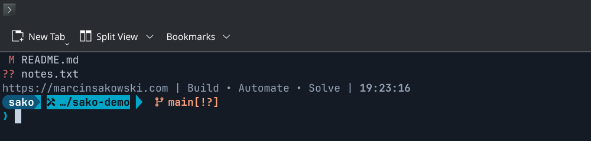

# SAKO Terminal Theme

**Build • Automate • Solve**

Trzywierszowy prompt Fish + Starship w kolorystyce SAKO oraz przenośny
instalator, który konfiguruje go na CachyOS, Arch, Debianie, Ubuntu, Mincie
i Fedorze.

**One theme. One installer. Multiple Linux environments.**

[English README](README.md)



## Szybki start

```bash
git clone https://github.com/Sako404/sako-terminal-theme.git
cd sako-terminal-theme
./install.sh
```

Instalator pokazuje plan (brakujące pakiety, pliki do utworzenia lub
podmiany), pyta raz, robi kopię wszystkiego, co zmienia, wdraża motyw
i sprawdza go w nowym procesie Fish. Można go uruchamiać wielokrotnie —
zmienia tylko to, co jest nieaktualne.

Brak gita na świeżym systemie? Zobacz [docs/installation.md](docs/installation.md#without-git).

## Co zawiera

| Warstwa | Co | Wymaga GUI? |
|---|---|---|
| **Core theme** | Prompt Starship (3 linie, segmenty Powerline, ikony Nerd Fonts), linia brandingu z bieżącą godziną, kolor autosugestii Fish `#7f8c9a` | Nie — działa przez SSH i w TTY |
| **Integracje terminali** (opcjonalne) | Schemat kolorów i czcionka dla KDE Konsole, Kitty, Alacritty, WezTerm | Tylko sam emulator |
| **Instalator** | Instalacja zależności, backup, przywracanie, aktualizacja, odinstalowanie, diagnostyka | Nie |

Core theme rysuje prompt i wygląda tak samo w każdym terminalu z czcionką
Nerd Font. Integracje ustawiają tylko tło, 16 kolorów ANSI i czcionkę
emulatora, żeby prompt był na właściwej palecie.

Wygląd jest przygotowany dla **Fish + Starship**. Instalator można uruchomić
z dowolnej powłoki (bash, zsh, fish), ale nie zmienia promptu Basha ani Zsh.

## Opcje instalatora

```text
./install.sh                 wykrycie, plan, jedno pytanie, instalacja
./install.sh --dry-run       tylko plan, bez zmian
./install.sh --yes           bez pytań (zabezpieczenia nadal działają)
./install.sh --core-only     tylko Fish + Starship, bez zmian w emulatorze
./install.sh --terminal konsole|kitty|alacritty|wezterm   (można powtarzać)
./install.sh --font | --no-font | --no-deps | --force | --help
```

Bez `--terminal` emulator jest wykrywany z drzewa procesów (nie z `$TERM`).
Jeśli jest nieznany albo nieobsługiwany, instalowany jest tylko Core theme.

## Komendy na co dzień

| Zadanie | Komenda |
|---|---|
| Diagnostyka | `scripts/doctor.sh` |
| Aktualizacja | `./update.sh` |
| Lista / przywrócenie backupu | `scripts/restore.sh --list`, `scripts/restore.sh <ID>` |
| Ręczny backup | `scripts/backup.sh` |
| Odinstalowanie | `./uninstall.sh` |
| Fish jako powłoka logowania (opcjonalnie) | `scripts/set-default-shell.sh` |

## Personalizacja

Slogan, kolory i czcionkę zmieniasz w **jednym pliku**:
`~/.config/sako-terminal-theme/local.conf` (tworzony przy pierwszej
instalacji), a potem uruchamiasz ponownie `./install.sh`. Szczegóły:
[docs/customisation.md](docs/customisation.md).

## Bezpieczeństwo

* Każdy zmieniany plik trafia najpierw do backupu (`~/.local/state/sako-terminal-theme/backups`).
* Pliki edytowane przez Ciebie po instalacji nie są nadpisywane bez `--force`.
* `config.fish`, aliasy, funkcje i pozostałe kolory Fish zostają nietknięte.
* Bez `curl | bash`. Pakiety pochodzą z oficjalnych repozytoriów; jedyne
  pobierania (Starship / Nerd Font, gdy repozytorium ich nie ma) to przypięte
  wydania sprawdzane sumami SHA-256 zapisanymi w `lib/deps.sh`.
* Powłoka logowania nigdy nie jest zmieniana automatycznie. Bez telemetrii i usług w tle.

## Dokumentacja (po angielsku)

* [Instalacja, aktualizacja, przywracanie, odinstalowanie](docs/installation.md)
* [Personalizacja](docs/customisation.md)
* [Obsługiwane systemy i terminale](docs/supported-systems.md)
* [Rozwiązywanie problemów](docs/troubleshooting.md)

## Licencja

[AGPL-3.0-or-later](LICENSE) © Marcin Sakowski — <https://marcinsakowski.com>
